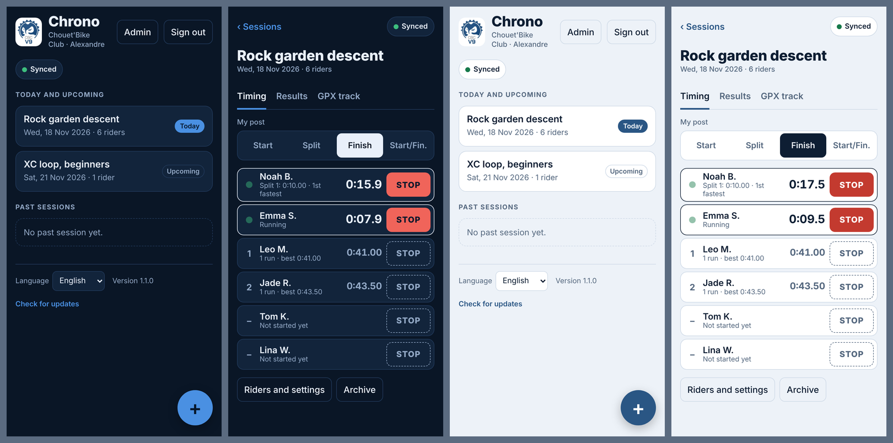

# Chrono

A training stopwatch for sports coaches, used on several phones at once and built to cope with weak mobile networks.

One coach stands at the start, others at split points or at the finish. A start tapped on one phone sets the stopwatch running on all the others. Each tap is saved on the phone with its exact time, then sent as soon as the network allows.



## Features

- Sessions with a name and a date, a list of riders per session, and archiving.
- A club list of riders (with groups) and a list of allowed coaches, managed by admins, with `.csv` import.
- Posts: **Start**, **Split**, **Finish**, and **Start/Finish** for laps on a circuit.
- Staggered and group starts, several riders on course at once, lap or finish chosen after the stop.
- Results per rider: every run, best, average and slowest time, split and lap details, `.csv` export.
- Offline: taps are stored on the phone and synced later; phone clocks are aligned on the server clock.
- GPX import after the session: distance, climb, speeds, and per-run speeds for the rider who carried the device.
- Installable on the home screen, several languages, your own name, logo and colours.

## How it is built

| Part | Service | Cost |
|---|---|---|
| The app (static files) | GitHub Pages | Free |
| Accounts, data, realtime sync | Supabase (choose a region close to you) | Free plan |
| Your own address, e.g. `chrono.example.org` | Your domain registrar | Optional |

Riders' names and times are stored only in Supabase and are visible only to signed-in coaches. The GitHub repository holds the code and your settings, nothing else.

### Files

| File | Role |
|---|---|
| `config.js` | **Edit**: your Supabase project URL and publishable key |
| `settings.js` | **Edit**: app name, club name, logo, languages, colours |
| `logo.png`, `icon-*.png`, `apple-touch-icon.png` | Your logo and home-screen icons |
| `version.js` | App version: increase it after changing code (see "Updating") |
| `lang/*.js` | Translations, one file per language |
| `index.html`, `app.js`, `styles.css` | The app |
| `sw.js`, `manifest.webmanifest` | Offline use, updates and home-screen install |
| `supabase/schema.sql` | Database set-up, run once in Supabase |
| `.github/workflows/keepalive.yml` | Keeps the free Supabase project from pausing |
| `docs/` | Screenshot for this README |

---

## Installation (30 to 45 minutes)

Everything is done in a web browser, ideally on a computer.

### Step 1: create the Supabase database

1. Create an account at https://supabase.com, then **New project**. Pick a region close to your users and note the database password it suggests (the app does not use it).
2. Open `supabase/schema.sql` from this repository and copy its whole content.
3. In Supabase: **SQL Editor > New query**, paste it.
4. **Still in the Supabase editor, just before running it**, go to the last lines and replace `admin@example.com` and `Admin Name` with your own email and name. You become the first admin. Do this only in Supabase, not in the file in your repository, so that your email never ends up on GitHub.
5. Click **Run**. The expected result is "Success. No rows returned".
6. **Authentication > URL Configuration**:
   - Site URL: the address of your app, e.g. `https://chrono.example.org` (or `https://YOUR-USER.github.io/REPO/` without a custom domain).
   - Redirect URLs: add the same address followed by `**`.
7. **Email confirmation.** Supabase's built-in email service is meant for testing: it sends only a couple of emails per hour, and only to members of your Supabase team. Two options:
   - **Simple (recommended to start)**: on the **Authentication > Sign In / Providers** page, in the **User Signups** section at the top, keep **Allow new users to sign up** on and turn **Confirm email** off, then save. Coaches then create their password and sign in at once. Only addresses in the coach list can create an account, so add each coach to the list just before their first sign-in, and check on the Admin screen that they show "account created".
   - **Stricter**: keep **Confirm email** on and connect your own mail sender in **Authentication > Emails > SMTP Settings** (a mailbox from your web host works). This also enables "Forgot password".

   Supabase moves its settings around from time to time. If **Confirm email** is not where described, you can instead create each account yourself: **Authentication > Users > Add user > Create new user**, with **Auto Confirm User** ticked, after adding the address to the coach list.

### Step 2: connect the app to the database

1. In Supabase, **Project Settings > API Keys**: copy the **Publishable** key (it starts with `sb_publishable_`). If you see a "Create new API keys" button, click it first.
2. The project URL (`https://xxxx.supabase.co`, nothing after `.co`) is under **Project Settings > Data API**, or behind the **Connect** button.
3. Put both values in `config.js`.

The publishable key is designed to be visible in a web page. Never put the **secret** key in this repository.

### Step 3: publish the app on GitHub Pages

1. Create a GitHub account if needed, then a new **public** repository (GitHub Pages on a free account requires a public repository).
2. Upload all the files of this folder, keeping the folders (`lang`, `docs`, `supabase`, `.github`) and the `.nojekyll` file. On Mac and Windows, files starting with a dot are hidden: show hidden files first. With git: `git add . && git commit -m "First version" && git push`.
3. **Settings > Pages**: Source **Deploy from a branch**, branch `main`, folder `/ (root)`, **Save**. After a minute the app is at `https://YOUR-USER.github.io/REPO/`.

### Step 4 (optional): use your own address

1. In **Settings > Pages > Custom domain**, enter e.g. `chrono.example.org` and save. GitHub adds a `CNAME` file to the repository.
2. At your domain registrar, add a DNS record: type **CNAME**, name `chrono`, target `YOUR-USER.github.io.` (your GitHub user name, or organisation name if the repository belongs to one, followed by `.github.io` and a final dot; the repository name is not part of it).
3. Once **Settings > Pages** shows "DNS check successful", tick **Enforce HTTPS**.
4. Update the Site URL and Redirect URLs in Supabase (step 1, point 6).

### Step 5: first sign-in and lists

1. Open the app, tap **First sign-in**, enter the email you used in step 1 and choose a password.
2. **Admin > Riders**: add riders one by one, or import a `.csv` with columns `name ; group` (group optional):
   ```
   name;group
   First Last;Group 1
   First Last;Group 2
   ```
3. **Admin > Coaches**: add each coach, or import a `.csv` with `name ; email ; role` (role = `admin` or `coach`). Each coach then taps **First sign-in** with that address.
4. On each phone, open the app and choose "Add to Home Screen" (browser menu on Android, Share button on iPhone).

### Quick check after installation

With two phones side by side:

- [ ] Create a session with two riders: it appears on the second phone.
- [ ] Post "Start" on one phone, "Finish" on the other: a start makes the stopwatch run on both.
- [ ] Turn on airplane mode on the start phone, start a rider, turn airplane mode off: the badge goes from "Offline · 1 waiting" to "Synced" and the rider appears running on the other phone.
- [ ] On GitHub, **Actions > Keep Supabase awake > Run workflow**: the run turns green.

---

## Customise the app

### Name, logo and colours

Everything is in `settings.js`:

- `appName`: the title shown in the app (e.g. `'Chrono'`).
- `clubName`: shown under the title and on the sign-in screen. Use `''` to hide it.
- `logo`: the image file shown in the app. Replace `logo.png` with your own (a PNG with a transparent background works best).
- `mode`: `'auto'` follows each phone's light or dark setting, `'dark'` or `'light'` forces one.
- `dark` and `light`: the colours of each theme, as hex codes like `'#2A5684'`. Each colour is described in the file. Keep enough contrast between `bg` and `ink` (background and text) and between each button colour and `actInk` (text on timing buttons).

Changes to `settings.js` reach the phones by themselves; see "Updating".

Three things live in other files because the phone reads them before the app starts:

- **Home-screen icons**: replace `icon-192.png` (192×192), `icon-512.png` (512×512), `icon-maskable-512.png` (512×512, logo within the central 80%, since Android crops the corners) and `apple-touch-icon.png` (180×180).
- **Name under the home-screen icon**: `name` and `short_name` in `manifest.webmanifest`.
- **Top bar colour while loading**: `theme_color` and `background_color` in `manifest.webmanifest`, and `theme-color` in `index.html`. Use the `bg` colour of your theme.

### Language

In `settings.js`:

- `languages`: the languages offered, e.g. `['en', 'fr']`. Each one is a file in the `lang/` folder. The first one is used when nothing else matches.
- `language`: `'auto'` uses the phone's language when it is in the list, or set one code to force it, e.g. `'fr'`.

Each user can also change language at the bottom of the home and sign-in screens; that choice is remembered on their phone.

### Add a language

1. Copy `lang/en.js` to `lang/xx.js`, where `xx` is the two-letter language code (`de`, `it`, `es`, `nl`…).
2. In the new file, change `self.CHRONO_LANGS.en` to `self.CHRONO_LANGS.xx`, set `_name` (shown in the language menu, e.g. `'Deutsch'`) and `_locale` (for dates and numbers, e.g. `'de-DE'`).
3. Translate the text on the right of each line. Keep the `{placeholders}` as they are. Lines like `{ one: '…', other: '…' }` hold the singular and plural forms. The few lines written as small functions (`ordinal`, `toast.ridersImported`) can be adapted or left in English.
4. Add `'xx'` to `languages` in `settings.js`, and increase `version.js`.

A missing line falls back to English, so a partial translation still works.

---

## Updating

### How phones get a new version

The app installed on a phone keeps a copy of its files so it works without network. Every time it is opened (or brought back to the foreground) with a connection, it checks for a new version in the background. When one is found, a banner appears: **"A new version of the app is ready" · Reload**. Tapping **Reload** switches to it. Times already recorded are never lost: they are saved on the phone before anything else.

There is also a **Check for updates** link at the bottom of the home screen, and the current version number is shown next to it.

So there is nothing special to do on the phones: open the app, wait a few seconds, tap **Reload**. If the banner does not appear, closing the app completely and opening it again also works.

### What to do after changing files

- **`settings.js` or `config.js`**: just publish (commit and push). Phones detect the change themselves.
- **Anything else** (`app.js`, `styles.css`, `index.html`, a file in `lang/`, the logo): also increase the number in `version.js`, e.g. `'1.1.0'` to `'1.1.1'`, then publish. Without this, phones keep the previous version until their copy refreshes on its own.

GitHub Pages takes about a minute to publish, and may serve the previous files for a few more minutes.

---

## Good to know

- **Free Supabase plan pausing**: a free project is paused after 7 days without activity, and can be restored from the dashboard for 90 days. The `keepalive.yml` job calls the database twice a week to prevent this. GitHub may disable that job after long periods without commits to the repository; it emails you and one click re-enables it.
- **Backups**: the free plan has none. Export important results to `.csv`.
- **Forgot password**: works only with your own mail sender (step 1, point 7). Otherwise delete the user in Supabase (**Authentication > Users**) and ask the coach to do **First sign-in** again.
- **Removing a coach**: Admin > Coaches > Remove. Their access to the data stops at once.
- **Removing a rider**: they disappear from selection lists; their past times stay readable.
- **Personal data**: the database holds names of young riders. Choose a Supabase region suited to your country's rules, keep the coach list to the people who need it, and inform families according to your club's practice.
- **Timing accuracy**: the time kept is the moment the finger touches the screen, with phone clocks aligned on the server clock at each connection. The limit is the coach's reaction time, typically one or two tenths of a second: fine for training, not for official results.
- **Troubleshooting**: "not connected to its database" means `config.js` still has the example values or a wrong URL. A refused "First sign-in" means the address is not in the coach list, or is spelled differently.
